<a href="https://www.jaimesmanicar.com/">
  <picture>
    <source media="(prefers-color-scheme: dark)" srcset="https://raw.githubusercontent.com/h4yme/h4yme/main/assets/banner-dark.svg">
    <source media="(prefers-color-scheme: light)" srcset="https://raw.githubusercontent.com/h4yme/h4yme/main/assets/banner-light.svg">
    
  </picture>
</a>

  <a href="https://www.jaimesmanicar.com/"><picture><source media="(prefers-color-scheme: dark)" srcset="https://raw.githubusercontent.com/h4yme/h4yme/main/assets/btn-site-dark.svg"><source media="(prefers-color-scheme: light)" srcset="https://raw.githubusercontent.com/h4yme/h4yme/main/assets/btn-site-light.svg"></picture></a>
  <a href="https://linkedin.com/in/jmanicar"><picture><source media="(prefers-color-scheme: dark)" srcset="https://raw.githubusercontent.com/h4yme/h4yme/main/assets/btn-linkedin-dark.svg"><source media="(prefers-color-scheme: light)" srcset="https://raw.githubusercontent.com/h4yme/h4yme/main/assets/btn-linkedin-light.svg"></picture></a>
  <a href="mailto:manicar.jaimesaldrich.trecero@gmail.com"><picture><source media="(prefers-color-scheme: dark)" srcset="https://raw.githubusercontent.com/h4yme/h4yme/main/assets/btn-email-dark.svg"><source media="(prefers-color-scheme: light)" srcset="https://raw.githubusercontent.com/h4yme/h4yme/main/assets/btn-email-light.svg"></picture></a>

<picture><source media="(prefers-color-scheme: dark)" srcset="https://raw.githubusercontent.com/h4yme/h4yme/main/assets/whoami-dark.svg"><source media="(prefers-color-scheme: light)" srcset="https://raw.githubusercontent.com/h4yme/h4yme/main/assets/whoami-light.svg"></picture>

<picture><source media="(prefers-color-scheme: dark)" srcset="https://raw.githubusercontent.com/h4yme/h4yme/main/assets/experience-dark.svg"><source media="(prefers-color-scheme: light)" srcset="https://raw.githubusercontent.com/h4yme/h4yme/main/assets/experience-light.svg"></picture>

<picture><source media="(prefers-color-scheme: dark)" srcset="https://raw.githubusercontent.com/h4yme/h4yme/main/assets/rule-work-dark.svg"><source media="(prefers-color-scheme: light)" srcset="https://raw.githubusercontent.com/h4yme/h4yme/main/assets/rule-work-light.svg"></picture>

<a href="https://sync-app-opal.vercel.app/"><picture><source media="(prefers-color-scheme: dark)" srcset="https://raw.githubusercontent.com/h4yme/h4yme/main/assets/project-sync-dark.svg"><source media="(prefers-color-scheme: light)" srcset="https://raw.githubusercontent.com/h4yme/h4yme/main/assets/project-sync-light.svg"></picture></a>

<a href="https://github.com/h4yme/LiteRise"><picture><source media="(prefers-color-scheme: dark)" srcset="https://raw.githubusercontent.com/h4yme/h4yme/main/assets/project-literise-dark.svg"><source media="(prefers-color-scheme: light)" srcset="https://raw.githubusercontent.com/h4yme/h4yme/main/assets/project-literise-light.svg">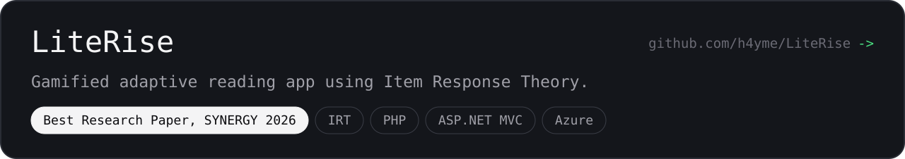</picture></a>

<a href="https://github.com/h4yme/LLISYNCH-Automated-School-Management-System"><picture><source media="(prefers-color-scheme: dark)" srcset="https://raw.githubusercontent.com/h4yme/h4yme/main/assets/project-llisynch-dark.svg"><source media="(prefers-color-scheme: light)" srcset="https://raw.githubusercontent.com/h4yme/h4yme/main/assets/project-llisynch-light.svg"></picture></a>

<picture><source media="(prefers-color-scheme: dark)" srcset="https://raw.githubusercontent.com/h4yme/h4yme/main/assets/stack-dark.svg"><source media="(prefers-color-scheme: light)" srcset="https://raw.githubusercontent.com/h4yme/h4yme/main/assets/stack-light.svg"></picture>

<picture><source media="(prefers-color-scheme: dark)" srcset="https://raw.githubusercontent.com/h4yme/h4yme/main/assets/stats-dark.svg"><source media="(prefers-color-scheme: light)" srcset="https://raw.githubusercontent.com/h4yme/h4yme/main/assets/stats-light.svg">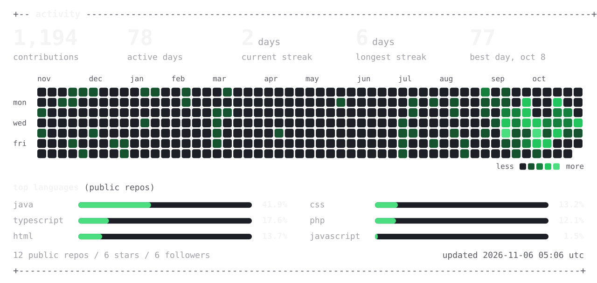</picture>
